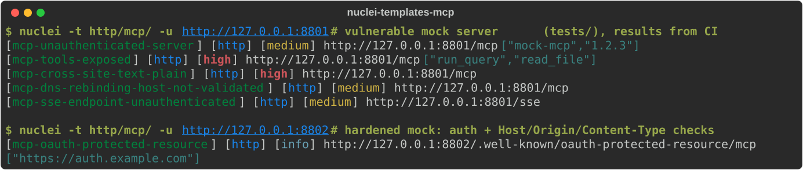

# nuclei-templates-mcp

**Nuclei templates that find exposed and misconfigured MCP servers: unauthenticated access, tools anyone can call, cross-site requests (CVE-2026-33252) and missing DNS-rebinding protection. Detection only.**

[](https://github.com/garag0l/nuclei-templates-mcp/actions/workflows/ci.yml)
[](LICENSE)




## Usage

```bash
git clone https://github.com/garag0l/nuclei-templates-mcp
nuclei -t nuclei-templates-mcp/http/mcp/ -u https://mcp.example.com
nuclei -t nuclei-templates-mcp/http/mcp/ -l targets.txt -jsonl -o mcp-findings.jsonl
```

Requires Nuclei v3.

## Why this exists

Trend Micro counted roughly 1,470 MCP servers exposed to the internet in 2026, many of them reachable without credentials. Several SDK advisories that year were about local servers that any web page could reach: missing DNS-rebinding protection, and cross-site `text/plain` requests that skip CORS preflight. Neither the public Nuclei templates nor the usual scanners had MCP-aware checks. These templates speak the protocol properly: a JSON-RPC `initialize` over Streamable HTTP, the legacy SSE transport, and RFC 9728 metadata.

## Templates

| Template | Severity | What it detects | How |
|---|---|---|---|
| `mcp-unauthenticated-server` | medium | Server completes `initialize` without credentials; extracts server name + version | One `initialize` POST to `/mcp`, `/mcp/`, `/v1/mcp`, `/api/mcp`, `/` |
| `mcp-tools-exposed` | high | Tool list readable without credentials; extracts tool names | `initialize` then `tools/list`. Works with stateful (session ID) and stateless servers. **Never calls a tool.** |
| `mcp-cross-site-text-plain` | high | Accepts JSON-RPC as `text/plain` from a foreign `Origin`, so any web page can drive it ([CVE-2026-33252](https://github.com/advisories/GHSA-89xv-2j6f-qhc8) behavior) | One `initialize` with a CORS-safelisted content type |
| `mcp-dns-rebinding-host-not-validated` | medium | Answers for an arbitrary `Host`/`Origin`, so DNS rebinding reaches local servers ([GHSA-w48q](https://github.com/advisories/GHSA-w48q-cv73-mx4w), [GHSA-9h52](https://github.com/advisories/GHSA-9h52-p55h-vw2f), [GHSA-xw59](https://github.com/advisories/GHSA-xw59-hvm2-8pj6)) | One `initialize` with a foreign Host header |
| `mcp-sse-endpoint-unauthenticated` | medium | Legacy HTTP+SSE transport open without credentials | `GET /sse`, reads 32 bytes, disconnects (an endless stream can't hang the scan) |
| `mcp-oauth-protected-resource` | info | RFC 9728 metadata; extracts the authorization servers clients are sent to | `GET /.well-known/oauth-protected-resource[/mcp]` |

**Severity context:** some MCP servers are public by design (documentation search, for example), so check the tool list before calling an unauthenticated server a vulnerability. The rebinding and cross-site templates matter most for servers on localhost and internal networks.

## How it was tested

- **CI on every push:**
  - `nuclei -validate` on all templates.
  - Every template runs against three mock MCP servers (`tests/mock_mcp_server.py`): vulnerable, stateless (no session ID, SSE-framed responses, as many hosted servers behave) and hardened (auth + Host/Origin/Content-Type checks). The run fails on any missing **or unexpected** match, and every template must have a positive test.
- **Real-world check:** run against intentionally public servers and OAuth-protected ones:
  - DeepWiki and Cloudflare's docs server: detected as unauthenticated (by design), with their 3 and 2 tools listed;
  - Notion and Linear: OAuth metadata extracted;
  - none of them falsely flagged for cross-site or rebinding.

## Responsible use

For servers you own or are authorized to test. The templates send the same requests any MCP client sends to start a session (`initialize`, `tools/list`) and **never invoke tools**. Scanning other people's infrastructure without permission may be illegal where you are.

## Contributing

New templates need a positive and a negative case in `tests/mock_mcp_server.py` / `tests/run_templates.py`. CI enforces both. False-positive reports with the response (redacted) are welcome.

## License

[MIT](LICENSE)
